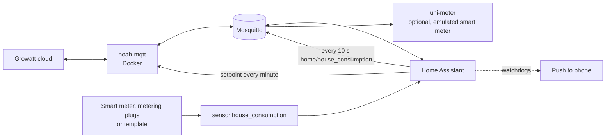

# NOAH zero export with Home Assistant

> 🇩🇪 German version: [noah-nulleinspeisung-de](https://github.com/Zedas030/noah-nulleinspeisung-de)

Every minute, sets the output power of a **Growatt NOAH 2000** (balcony solar battery) so that
it roughly covers the current household consumption and gives away as little as possible to the grid.
On top of that: deep discharge protection for the batteries, monitoring of the charge levels of the
main and extension battery, and two watchdogs that notify your phone when the control loop stops.

Running since October 2026 on a Raspberry Pi with Home Assistant, Mosquitto and Docker.

## Data flow

## How the control loop calculates

Every minute, when all values are available:

| Quantity | Rule |
|---|---|
| Target | household consumption minus buffer, at least 50 W |
| Buffer | 70 W at SoC above 60 %, 90 W above 30 %, otherwise 150 W |
| Upper limit | 800 W, below 20 % SoC only 100 W, below 15 % SoC 0 W (deep discharge protection) |
| SoC | always the **lower** of the two batteries |
| Hysteresis | new setpoint only if it differs by at least 40 W |
| Battery drift | if the batteries differ by more than 6 % during the day, output is throttled to 100 W and a notification is sent |

The buffer deliberately allows a little grid import. That way the battery covers the base load without
chasing every short load spike and feeding power into the grid while doing so.

### Example

Household consumption 420 W, batteries at 55 % and 58 %, sun is shining, last setpoint 300 W:

1. The SoC for all rules is the lower value, so 55 %. Buffer is therefore 90 W, upper limit 800 W.
2. Target = 420 − 90 = 330 W, which is between 50 and 800 W.
3. Battery difference 3 %, so no throttling.
4. 330 W differs from the last setpoint by only 30 W, below the 40 W hysteresis. Nothing is sent.

## Building blocks

| File | Purpose |
|---|---|
| [homeassistant/automations.yaml](homeassistant/automations.yaml) | control loop, household consumption via MQTT, two watchdogs |
| [homeassistant/helpers.yaml](homeassistant/helpers.yaml) | required helpers and an example for `sensor.house_consumption` |
| [docker/docker-compose.yml](docker/docker-compose.yml) | [noah-mqtt](https://github.com/mtrossbach/noah-mqtt) and optionally [uni-meter](https://github.com/sdeigm/uni-meter) |
| [docker/uni-meter/uni-meter.conf.example](docker/uni-meter/uni-meter.conf.example) | emulated smart meter fed from the MQTT topic `home/house_consumption` |
| [pi/noah-mqtt.service](pi/noah-mqtt.service) | systemd keeps the container alive |
| [pi/noah-mqtt-ensure.sh](pi/noah-mqtt-ensure.sh) | restart via a forced SSH command, callable from Home Assistant |

noah-mqtt and uni-meter are third-party projects. They are only used here as Docker images,
their code is not part of this repo.

## Setup

1. **Start noah-mqtt.** Copy `docker/.env.example` to `.env`, enter your MQTT and Growatt
   credentials, `docker compose up -d noah-mqtt`. The NOAH shows up in Home Assistant via MQTT discovery,
   with entities such as `sensor.noah_2000_bat0_soc` and `number.noah_2000_system_output_power`.
2. **Create the helpers** from `helpers.yaml`, plus a sensor `sensor.house_consumption` in watts.
3. **Import the automations** from `automations.yaml`. Adapt the entity IDs to your own system,
   especially the extension battery (`sensor.noah_2000_bat1_soc`; on some systems the ID contains
   the serial number) and the notification service (`notify.mobile_app_my_phone`).
4. Optionally start **uni-meter** with the example configuration if a device on your LAN expects a
   smart meter.
5. Optionally set up the **systemd watchdog** and the **SSH script** on the Docker host.

## Troubleshooting

| Symptom | Cause and fix |
|---|---|
| Setpoint doesn't change for hours | Normal when the battery sits at the discharge limit or consumption stays within the hysteresis. That's why the watchdog only warns when the battery is above the discharge limit plus 3 %. |
| Automation never runs | One of the entities in the "All entities available" condition is `unavailable`. Check under Developer tools → States; usually noah-mqtt isn't connected. |
| NOAH entities missing in Home Assistant | Set up the MQTT integration in HA and check `docker logs noah-mqtt` for login errors against the Growatt cloud. |
| Constant switching between two setpoints | Household consumption fluctuates around the hysteresis. Raise the hysteresis to 60 W or smooth the consumption sensor. |

## Credentials and your own values

The repo contains no real credentials, no IP addresses and no serial numbers. These spots
must be filled with your own values:

| What | In the repo | Where the real value goes |
|---|---|---|
| MQTT broker address | `<mqtt-host>` | `MQTT_HOST` in `docker/.env` (template [`docker/.env.example`](docker/.env.example)) and `url` in `docker/uni-meter/uni-meter.conf` |
| MQTT user and password | `<mqtt-user>`, `<mqtt-password>` | `MQTT_USERNAME`, `MQTT_PASSWORD` in `docker/.env`, plus `user`/`password` in `docker/uni-meter/uni-meter.conf` |
| Growatt cloud login | `<growatt-login>`, `<growatt-password>` | `GROWATT_USERNAME`, `GROWATT_PASSWORD` in `docker/.env` |
| uni-meter configuration | [`uni-meter.conf.example`](docker/uni-meter/uni-meter.conf.example) | copy to `docker/uni-meter/uni-meter.conf` and fill in |
| Extension battery entity | `sensor.noah_2000_bat1_soc` | replace with your own ID in [`homeassistant/automations.yaml`](homeassistant/automations.yaml). On some systems it contains the serial number. |
| Phone notification | `notify.mobile_app_my_phone` | replace in `automations.yaml` with your own Companion app service |
| Household consumption | `sensor.house_consumption` | your own sensor, example in [`homeassistant/helpers.yaml`](homeassistant/helpers.yaml) |
| Folder on the Docker host | `/opt/noah-zero-export/docker` | `WorkingDirectory` in [`pi/noah-mqtt.service`](pi/noah-mqtt.service) |
| SSH key for restarts from Home Assistant | not included | create your own key and add it to the Docker host's `~/.ssh/authorized_keys` with `command="/path/noah-mqtt-ensure.sh"` |

`docker/.env` and `docker/uni-meter/uni-meter.conf` are listed in `.gitignore`.

## Limitations

- The data comes through the Growatt cloud, not locally from the device. If the cloud goes down,
  the control loop stops. Hence the watchdogs.
- New setpoints only take effect after noah-mqtt's next poll, so the control loop is deliberately
  slow and not meant for second-by-second tracking.
- The thresholds (15 %, 20 %, buffer, 6 % drift) are empirical values for this one system,
  not manufacturer specifications.

## License

MIT for the files in this repo, see [LICENSE](LICENSE).
